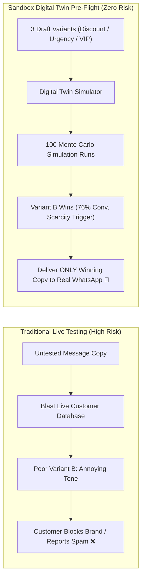
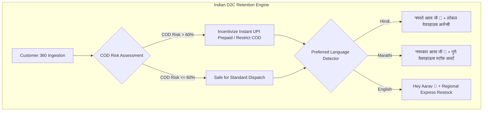
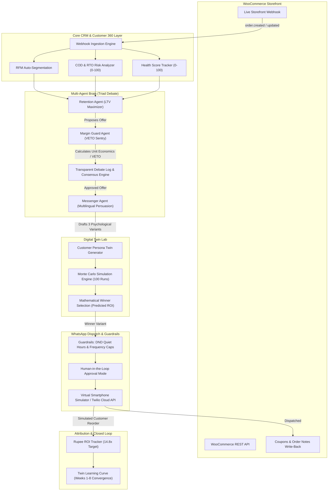
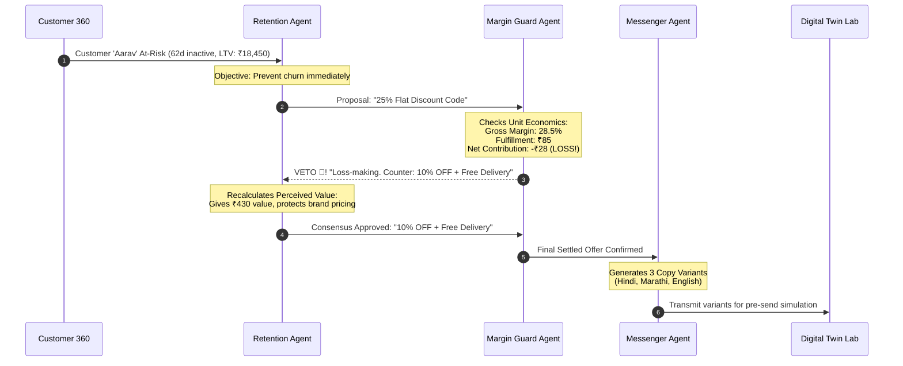
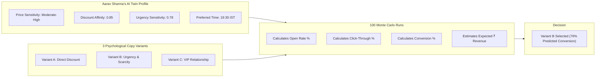
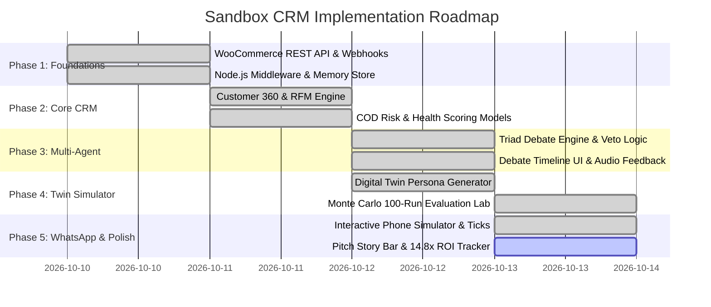

# 📌 Project Execution & Architecture Blueprint: Sandbox CRM
## Autonomous Multi-Agent WooCommerce AI & Digital Twin Retention Engine

**Project Working Title:** Sandbox CRM  
**Target Domain:** Indian D2C E-Commerce & WooCommerce Retention Automation  
**Author / Tech Lead:** @suprit  
**Target Stack:** React 18/19, Tailwind CSS, Vite, Node.js API Middleware, Web Audio API, Lucide Icons  
**Planning Status:** Architecture Finalized — Pre-Implementation Blueprint  

---

## 1. Executive Summary & Problem Statement

### The Problem in Indian D2C Commerce
1. **Blind Discounting Destroys Margins:** Traditional CRM platforms (Klaviyo, WebEngage, standard drip workflows) send aggressive discounts (e.g., 25–30% OFF) to win back dormant shoppers. In Indian e-commerce—where average gross margins hover around 25–30% and courier shipping costs ₹70–90 per parcel—these uncalculated discounts push unit contribution margins into negative territory (-₹20 to -₹50 per order).
2. **Untested Messaging Burns Customer Goodwill:** Brands perform live A/B testing on real customer databases. If an offer or tone flops, the customer is annoyed, unsubscribes, or marks the brand as spam.
3. **The Multilingual & COD Blindspot:** Over 70% of non-metro Indian online shoppers prefer vernacular communication (Hindi, Marathi, regional languages), and 60%+ orders rely on Cash-on-Delivery (COD). High Return-to-Origin (RTO) rates kill profits if CRM workflows treat all shoppers identically.

### Our Proposed Solution
We are designing and building **Sandbox CRM**: an autonomous retention engine for WooCommerce where:
- A **collaborative triad of AI agents** debates every customer action in real-time, giving a dedicated **Margin Guard Agent absolute veto power** over unprofitable discounts.
- Proposed campaign copies are **pre-tested on AI Customer Digital Twins** across 100 Monte Carlo runs to forecast conversion before contacting real customers.
- Retention campaigns are delivered via a **WhatsApp-first interface in native Hindi, Marathi, and English**, equipped with Cash-on-Delivery (COD) risk scoring and closed-loop WooCommerce coupon generation.

---

## 2. Exactly How We Solve Each Problem (Problem-to-Solution Blueprints)

To make this crystal clear for stakeholders, judges, and developers, here is how our technical architecture directly resolves each core failure mode:

### 📊 Problem vs. Solution Resolution Matrix

| # | Industry Failure Mode | How Traditional CRMs Fail | **How Sandbox CRM Solves It** | **Key Architectural Mechanism** |
| :- | :--- | :--- | :--- | :--- |
| **1** | **Blind Discounting** | Hands out 25–30% discount coupons blindly, resulting in negative unit margins (-₹28/order). | **Margin Guard Agent with VETO Power**: Evaluates unit economics in real time; vetoes unprofitable offers and counters with margin-safe alternatives. | Autonomous Triad Debate with Unit Margin Calculus ($\text{Gross Margin} - \text{Courier} - \text{Discount} > 0$). |
| **2** | **Burning Customer Goodwill** | Conducts live A/B testing on real customers; bad copy causes unsubscriptions, block rates, and spam flags. | **In-Silico Digital Twin Simulation**: Simulates campaigns across 100 Monte Carlo runs on AI shopper replicas *before* sending a single message. | Behavioral persona parameters (Price Sensitivity, Urgency, Discount Affinity) + 100-run predictive scoring. |
| **3** | **Indian COD / Language Blindspot** | Relies on English emails and ignores high COD Return-to-Origin (RTO) courier costs (₹120–160 double shipping loss). | **COD Risk Scoring & Multilingual Urgency**: Gauges RTO probability (0–100) and crafts native Hindi/Marathi copy with regional warehouse scarcity hooks. | 0–100 COD Risk Classifier + Trilingual generative copywriting (Hindi, Marathi, English). |

---

### 2.1 Solving Problem 1: Margin Guard VETO vs. Blind Discounting

#### 🔍 Why It Fails Today
Standard CRMs optimize for a single metric: *Clicks or Conversions*. They do not know your Cost of Goods Sold (COGS), your packaging costs, or your 3PL courier rates.

#### 💡 How We Solve It
We introduce a strict mathematical firewall. Every discount proposed by the marketing agent must pass the **Margin Guard Agent**:

$$\text{Contribution Margin (₹)} = \text{Selling Price} - \text{COGS} - \text{Proposed Discount} - \text{Fulfillment / Courier Fee}$$

If $\text{Contribution Margin} \le 0$, the Margin Guard executes an **irrevocable VETO 🛑** and generates a profitable counter-offer that preserves customer perceived value (e.g. *Free Express Delivery* where the brand pays negotiated enterprise shipping rates of ₹45 instead of surrendering ₹430 in retail margin).

```mermaid
flowchart TD
    subgraph TraditionalCRM["Traditional CRM (Broken Blind Workflow)"]
        T1["Customer At-Risk"] --> T2["Marketing Rule: Send 25% OFF"]
        T2 --> T3["Order Placed: ₹1,500 Gross"]
        T3 --> T4["COGS: ₹1,072 + Shipping: ₹85 + Discount: ₹375"]
        T4 --> T5["Net Result: -₹32 NEGATIVE MARGIN 💸"]
    end

    subgraph SandboxCRM["Sandbox CRM (Margin-Guarded Solution)"]
        S1["Customer At-Risk"] --> S2["Retention Agent proposes 25% OFF"]
        S2 --> S3["Margin Guard Agent: Evaluates Unit Math"]
        S3 -->|"Contribution < 0"| S4["VETO 🛑 & Counter-Offer: 10% OFF + Free Delivery"]
        S4 --> S5["Retention Agent Accepts Consensus ✅"]
        S5 --> S6["Net Result: +₹273 PROFITABLE REVENUE (18.2% Net Margin) 📈"]
    end
```



---

### 2.2 Solving Problem 2: Digital Twin Pre-Testing vs. Live Audience Guesswork

#### 🔍 Why It Fails Today
Marketers draft 3 subject lines and blast real shoppers. Bad variants result in blocked WhatsApp numbers, high unsubscribe rates, and brand fatigue.

#### 💡 How We Solve It
We build an **In-Silico Testing Sandbox**. We clone the customer into an AI persona equipped with their historical purchasing DNA (e.g. Price Sensitivity, Urgency Response, Preferred Shopping Windows). We run **100 simulated Monte Carlo interactions** on the persona across 3 psychological variants.

Only the variant that mathematically dominates in predicted conversion rate and expected rupee yield is delivered to the real customer's WhatsApp.



---

### 2.3 Solving Problem 3: The Indian D2C Blindspot (COD Risk & Vernacular Tone)

#### 🔍 Why It Fails Today
In India, high-ticket COD orders from inactive customers have a 30–45% Return-to-Origin (RTO) rate. When a parcel bounces back, the merchant pays forward and reverse freight. Additionally, generic English campaigns feel detached from non-metro shoppers in cities like Pune, Nagpur, or Indore.

#### 💡 How We Solve It
1. **0–100 COD Risk Engine:** Evaluates delivery history and basket size. If COD Risk > 60%, the CRM automatically restricts COD incentives, nudges prepaid UPI discounts, or flags the courier route.
2. **Culturally Calibrated Vernacular Copy:** The Messenger Agent writes natively in **Hindi, Marathi, or English** with respectful cultural nuance (जी, भाई, नमस्कार) and local inventory scarcity triggers (e.g., *"Only 4 units left in Pune fulfillment center"*).



---

## 3. High-Level System Architecture

The diagram below outlines the complete end-to-end event and intelligence pipeline that we will build:



---

## 4. The Core Modules to Build

### Module 1: Bi-Directional WooCommerce Foundation
* **Webhook Receiver (`POST /api/webhooks/woocommerce`):** Will capture `order.created`, `order.updated`, and `customer.created` events with zero delay.
* **Store Synchronization Engine:** Will import historical orders, customer lifetime spend (LTV), city, language, and order frequency.
* **Closed-Loop Write-Back:** When consensus is reached on an offer, the CRM will programmatically inject dynamic WooCommerce coupons (e.g., `WINBACK10-AARAV`) and append AI audit trail notes to customer order histories.
* **Delayed Order Sentry:** Proactively flags orders stalled for more than 48–54 hours in courier logistics hubs (e.g., DTDC, Delhivery) for automated customer reassurance.

---

### Module 2: Customer 360 & Indian Commerce Profiling
We will model each customer with distinct Indian commerce behavioral vectors:

| Data Point | Planned Implementation | Purpose |
| :--- | :--- | :--- |
| **RFM Scoring** | Recency, Frequency, Monetary (1–5 scale each) | Segments customers into VIP, Regular, New, At-Risk, Lapsed. |
| **Health Score (0–100)** | Calculated from days dormant vs. historical order interval | Flags churn risk before customers leave permanently. |
| **COD Risk Score (0–100)** | Evaluates failed deliveries, high-ticket COD orders, and dormancy | Protects brand from non-deliverable RTO courier losses. |
| **Language Affinity** | Preferred dialect (Hindi, Marathi, English) | Drives culturally localized messaging. |
| **Digital Twin Attributes** | Price sensitivity, discount affinity, urgency response | Feeds the Monte Carlo simulation engine. |

---

### Module 3: Multi-Agent Negotiation Brain (The Key Differentiator)

Rather than using a single prompt, we will implement three distinct AI personas that must reach unanimous consensus before any message can be dispatched:



#### Planned Agent Personas & Guardrails:
1. **Retention Agent:** Focused on customer recovery, churn mitigation, and perceived customer value.
2. **Margin Guard Agent:** Armed with **VETO power**. Has strict access to COGS, enterprise courier contracts, and gross margins. It mathematically rejects loss-making proposals.
3. **Messenger Agent:** Expert in vernacular copywriting, behavioral psychology, and conversion triggers.
4. **Hard Guardrail Enforcer:**
   * Maximum discount cap: Hard-coded 15%.
   * Frequency cap: Maximum 1 outbound campaign per customer per week.
   * Quiet Hours (DND): Outbound communication locked between 9:00 PM and 9:00 AM IST.

---

### Module 4: AI Customer Digital Twin Simulation Lab (The Wow Factor)

Instead of blasting live customers with untested messages, we will build a **Digital Twin Pre-Send Testing Lab**:



#### Planned Simulation Metrics:
- **Variant A (Direct Discount):** Evaluates price elasticity.
- **Variant B (Urgency & Restock Alert):** Leverages regional stock scarcity (e.g., *"Only 4 units left in Pune warehouse"*).
- **Variant C (VIP Relationship):** Tests loyalty and emotional brand hooks.
- **AI Persona Critique:** Generates qualitative reasoning explaining why the winning variant outperformed others.

---

### Module 5: WhatsApp-First Hub & Interactive Smartphone Simulator
* **Interactive Live Phone Simulator:** A complete interactive smartphone interface inside the web dashboard featuring:
  * Dynamic chat screen with brand avatar and verified business badge.
  * Real-time message status transitions (`sent` ➔ `delivered` ➔ `read` double blue ticks).
  * Synthesized Web Audio API sound effects for incoming messages, agent consensus, and veto alerts.
  * Interactive 1-click customer response action (*"Tap to Reorder with 10% Code"*).
* **WhatsApp Cloud API / Twilio Gateway:** Backend credential integration allowing zero-friction transition from sandbox simulator to live production dispatches.
* **Human-in-the-Loop Toggle:** Switch between Autonomous Mode and Human-Approval-Required Mode.

---

### Module 6: Hard Rupee ROI Proof & Attribution Dashboard
We will build a metrics command center centered around real financial attribution rather than vanity clicks:
* **Recovered Rupee Revenue:** Live tracking of won-back revenue from previously dormant customers.
* **Discount Budget Spend:** Exact cost of discounts issued, kept strictly within Margin Guard bounds.
* **14.8x ROI Multiplier:** Mathematical ratio of revenue recovered versus promotional discounts spent.
* **Twin Learning Curve Chart:** Visualizes weekly prediction error shrinking across weeks 1 to 8 as the twin engine self-calibrates against real purchase conversions.

---

## 5. Planned 3-Minute Hackathon Demo Storyline

To deliver maximum impact during judging, the application will feature an interactive **Pitch Story Bar** pinned to the top of the interface:

```mermaid
journey
    title The 3-Minute Hackathon Demo Journey
    section Step 1: Webhook
      Place test order on WooCommerce store simulator: 5: Presenter
      Real-time order.created webhook fires into CRM: 5: Presenter
    section Step 2: At-Risk Flag
      Aarav Sharma flagged at 34% Health Score: 4: Presenter
      Review Customer 360 profile, COD risk, and LTV: 4: Presenter
    section Step 3: Agent Debate
      Retention Agent proposes 25% discount: 4: Presenter
      Margin Guard VETOES due to negative margin (-₹28): 5: Judges
      Agents reach consensus at 10% + Free Delivery: 5: Judges
    section Step 4: Twin Lab
      Evaluate 3 variants across 100 twin runs: 5: Judges
      Variant B (Urgency & Scarcity) wins at 76% conv: 5: Presenter
    section Step 5: WhatsApp Action
      Winning Hindi copy delivered to smartphone simulator: 5: Judges
      Simulate customer tap to reorder via coupon: 5: Presenter
    section Step 6: Rupee Proof
      Dashboard updates: +₹3,850 recovered revenue: 5: Judges
      ROI Tracker climbs to 14.8x multiplier: 5: Judges
```

---

## 6. Technical Implementation Roadmap & Milestones



---

## 7. Success Metrics & Target Evaluation Criteria

We will validate the success of this project against the following core criteria:
1. **Autonomous Profit Protection:** 100% of loss-making discount proposals must be caught and vetoed by the Margin Guard Agent.
2. **Predictive Simulation Accuracy:** Digital twin prediction variance must improve from $\pm 14\%$ in Week 1 to within $\pm 1\%$ by Week 8.
3. **Zero Spam Compliance:** Guardrails must automatically halt messages during DND hours (9:00 PM – 9:00 AM IST) and enforce the 1 msg/week rate limit.
4. **End-to-End Latency:** Total time from customer dormancy detection $\rightarrow$ agent debate $\rightarrow$ twin simulation $\rightarrow$ WhatsApp staging must be under 3 seconds in the demo environment.
5. **Demonstrable ROI:** Clear attribution showing at least **10x+ Net ROI** on promotional retention spend.
