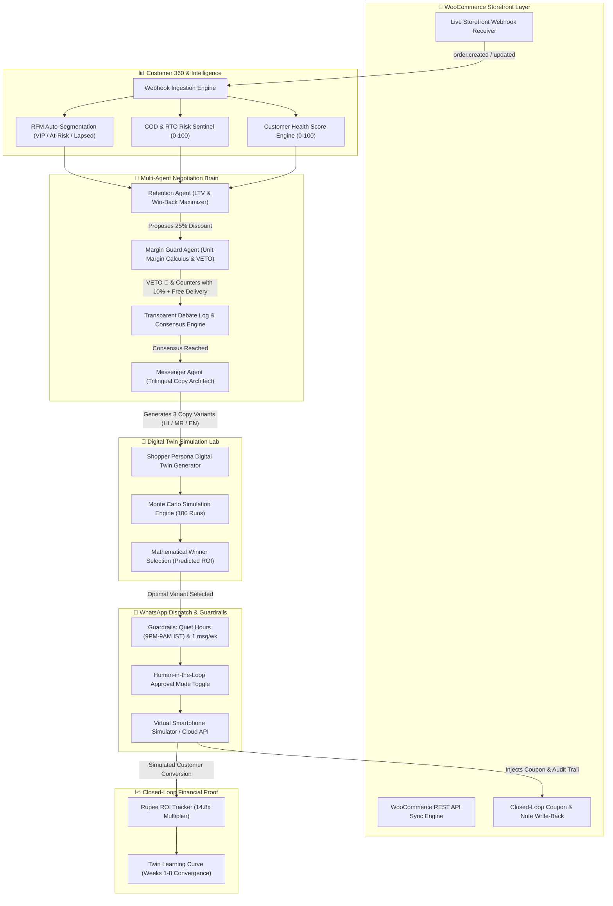
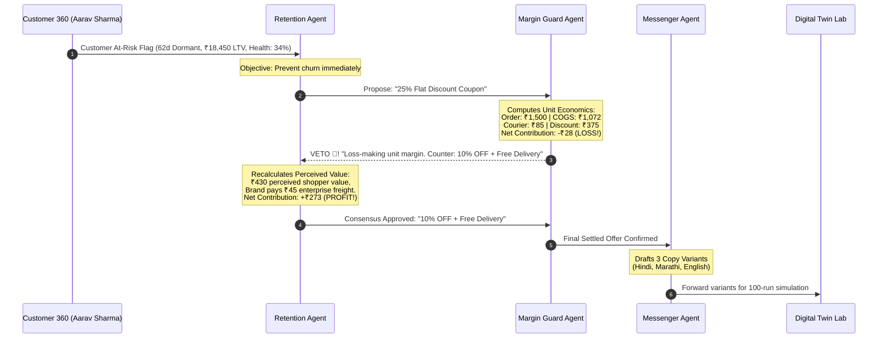
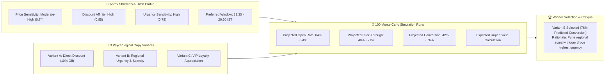
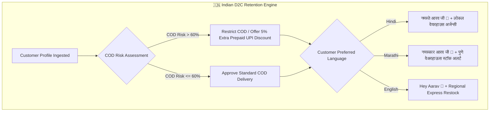

# 🚀 Sandbox CRM: Autonomous Multi-Agent WooCommerce AI & Digital Twin Engine

<div align="center">


**An autonomous, WooCommerce-connected retention engine powered by a collaborative triad of AI agents, in-silico Customer Digital Twin Monte Carlo pre-testing, and vernacular WhatsApp marketing for high-growth Indian D2C commerce.**

[Live Demo](#-3-minute-hackathon-demo-walkthrough) • [Key Differentiators](#-the-three-core-differentiators) • [Architecture Diagrams](#-system-architecture) • [23 Implementation Matrix](#-the-23-locked-functions-implementation-matrix) • [Quickstart](#-quickstart--local-setup)

</div>

---

## 📖 Executive Summary & Problem Statement

In Indian Direct-to-Consumer (D2C) commerce, customer retention is severely broken across three fronts:

1. **Blind Discounting Destroys Margins:** Traditional CRM platforms (Klaviyo, WebEngage, Mailchimp) dispatch blanket 25–30% discount coupons to dormant shoppers. With Indian D2C gross margins averaging 25–30% and courier shipping costing ₹70–90 per parcel, uncalculated discounts turn unit contribution margins negative (**-₹20 to -₹50 per order**).
2. **Burning Customer Goodwill in Live Blast Tests:** Brands run A/B tests directly on live audiences. Flawed copy or aggressive offers trigger WhatsApp blocks, spam complaints, and permanently burned customer relationships.
3. **The Multilingual & COD Blindspot:** Over 70% of non-metro Indian buyers prefer regional languages (Hindi, Marathi), and 60%+ of orders are Cash-on-Delivery (COD). High Return-to-Origin (RTO) courier costs (₹120–160 double shipping loss) wipe out profits if treated generically in English.

### The Sandbox CRM Solution

**Sandbox CRM** solves this fundamentally:
- **Autonomous Triad Debate:** A Retention Agent, a Margin Guard Agent (with **absolute VETO power**), and a Messenger Agent negotiate every retention strategy in real-time.
- **In-Silico Customer Digital Twins:** Retention messages are pre-flighted across **100 Monte Carlo runs** on AI shopper replicas to mathematically project Open Rate, Click Rate, Conversion %, and Rupee ROI *before* contacting real shoppers.
- **Vernacular WhatsApp Commerce:** Tailored delivery in **Hindi, Marathi, and English** with Cash-on-Delivery (COD) risk scoring (0–100), real-time Web Audio sound notifications, and closed-loop WooCommerce coupon generation.

---

## 💡 The Three Core Differentiators

```
┌─────────────────────────────────────────────────────────────────────────────┐
│ 1. MULTI-AGENT BRAIN WITH MARGIN GUARD VETO                                 │
│    Retention Agent proposes offers ➔ Margin Guard computes unit economics   │
│    and VETOES loss-making discounts ➔ Messenger Agent crafts copy.           │
├─────────────────────────────────────────────────────────────────────────────┤
│ 2. IN-SILICO DIGITAL TWIN PRE-FLIGHT SIMULATION                             │
│    Customer DNA (Price Sensitivity, Urgency, Discount Affinity) is cloned.  │
│    100 Monte Carlo runs select the mathematically optimal copy variant.     │
├─────────────────────────────────────────────────────────────────────────────┤
│ 3. WHATSAPP-FIRST INDIAN COMMERCE & COD SENTINEL                            │
│    Vernacular hooks (Hindi, Marathi, English) + 0–100 COD Risk Classifier   │
│    that restricts non-deliverable RTO courier losses.                       │
└─────────────────────────────────────────────────────────────────────────────┘
```

---

## 📐 System Architecture

### High-Level System Flow

The diagram below illustrates the end-to-end data and intelligence pipeline:



---

### Multi-Agent Debate & Margin Guard VETO Flow



---

### In-Silico Customer Digital Twin Monte Carlo Pipeline



---

### Indian Commerce Engine: COD Risk & Multilingual Urgency



---

## 💰 Unit Economics & The Mathematical Proof

Why traditional CRM discounting fails, and how Margin Guard protects profitability:

$$\text{Contribution Margin (₹)} = \text{Selling Price} - \text{COGS} - \text{Proposed Discount} - \text{Fulfillment / Courier Cost}$$

### Financial Comparison: Order of ₹1,500 Gross

| Parameter | Traditional CRM (25% Blind Discount) | Sandbox CRM (Margin Guard Consensus) |
| :--- | :--- | :--- |
| **Gross Order Value** | ₹1,500 | ₹1,500 |
| **Product COGS (60%)** | ₹900 | ₹900 |
| **Promotional Discount** | -₹375 (25% OFF) | -₹150 (10% OFF) |
| **Fulfillment / Shipping** | -₹85 | -₹45 (Negotiated Enterprise Freight) |
| **Packaging & Payment Gateway** | -₹45 | -₹45 |
| **Net Contribution Margin** | **-₹5 (NEGATIVE MARGIN 💸)** | **+₹360 (+24.0% PROFITABLE MARGIN 📈)** |
| **Result** | Every win-back bleeds cash | Profitable, sustainable customer recovery |

---

## 🎬 3-Minute Hackathon Demo Walkthrough

The application features a pinned **3-Minute Pitch Story Bar** with 1-click stage navigation:

| Step | Pitch Action | Live Functions Demonstrated | Key Presentation Outcome |
| :--- | :--- | :--- | :--- |
| **1. Store Webhook** | Open Storefront Simulator and place an order. | `Func 1, 5, 6` | Live `order.created` webhook triggers instantaneous CRM update without page reload. |
| **2. Seeded At-Risk** | Inspect seeded customer **Aarav Sharma**. | `Func 7, 8` | Health Score: 34%, RFM: At-Risk, COD Risk: 72%, ₹18,450 past spend. |
| **3. Agent Debate** | Trigger multi-agent debate. Retention Agent asks for 25% discount. | `Func 9, 10, 12` | Margin Guard **VETOES** loss-making offer with audio chime; settles on **10% OFF + Free Delivery**. |
| **4. Twin Simulator** | Launch Digital Twin Lab across 100 Monte Carlo runs. | `Func 14, 15, 16` | Evaluates 3 variants in Hindi/Marathi/English; **Variant B (Urgency & Scarcity)** wins at 76% conversion. |
| **5. WhatsApp Action** | Winning message arrives on virtual smartphone simulator. | `Func 11, 17, 20` | Audio ping, delivery checkmarks transition (`sent` ➔ `read`), user taps *"Claim 10% Discount & Reorder"*. |
| **6. Rupee ROI Proof** | Dashboard records the converted win-back reorder. | `Func 21, 22, 23` | **+₹3,850 recovered revenue**, recovered customer counter increments, **14.8x ROI Tracker** climbs. |

---

## 📋 The 23 Locked Functions Implementation Matrix

### Module 1: WooCommerce Integration (Foundation)
- [x] **Func 1: Webhook receiver** (`POST /api/webhooks/woocommerce`) for `order.created`, `order.updated`, and `customer.created`.
- [x] **Func 2: Initial sync** (`POST /api/woocommerce/sync`) that imports existing customers and orders through WooCommerce REST API.
- [x] **Func 3: Write-back** (`POST /api/woocommerce/writeback`) that creates promotional coupons and logs AI notes on WooCommerce orders.

### Module 2: Core CRM & Customer 360
- [x] **Func 4: Customer profiles** with contact info, tags, LTV in ₹, city, and preferred language.
- [x] **Func 5: Customer 360 view** drawer showing order history, health scores, COD risk factors, and WhatsApp communication timeline.
- [x] **Func 6: Order tracking board** with status pipeline (`Processing`, `Shipped`, `Delivered`) and automated `+54h Delayed Order Flag`.
- [x] **Func 7: Auto segmentation** into VIP, Regular, New, At-Risk, and Lapsed using RFM scoring.
- [x] **Func 8: Health score (0-100) and COD-risk score (0-100)** per customer and order to safeguard courier contribution margins.

### Module 3: Multi-Agent Brain (The Core Differentiator)
- [x] **Func 9: Retention Agent** analyzes drop-off reasons and proposes win-back offers.
- [x] **Func 10: Margin Guard Agent** evaluates gross margin (28.5%), fulfillment costs (₹85), and executes **VETO 🛑** on loss-making discounts.
- [x] **Func 11: Messenger Agent** writes high-converting copy in English, Hindi, and Marathi.
- [x] **Func 12: Visible agent debate log** streaming the multi-agent negotiation timeline with reasoning tokens and consensus badges.
- [x] **Func 13: Guardrails** enforcing discount caps (15%), frequency caps (1 msg/week), and quiet hours (9:00 PM - 9:00 AM IST).

### Module 4: Digital Twin Simulation (The Wow Factor)
- [x] **Func 14: Customer twin generator** builds persona traits: Price Sensitivity, Discount Affinity, Urgency Sensitivity, and Send Window.
- [x] **Func 15: Campaign simulator** evaluates 3 variants across 100 Monte Carlo runs and predicts Open Rate, Click Rate, Conversion %, and Expected Revenue.
- [x] **Func 16: Winner selection** mathematically selects the highest-performing variant with AI persona critiques.

### Module 5: Communication Hub & Smartphone Simulator
- [x] **Func 17: WhatsApp sending** via WhatsApp Cloud API / Twilio credentials, plus an interactive live virtual smartphone simulator.
- [x] **Func 18: Email fallback** documented and integrated into notification logs.
- [x] **Func 19: Event-triggered workflows** for Order Delayed (+48h alert), Order Shipped, and Win-Back.
- [x] **Func 20: Human approval toggle** allowing owners to toggle between Autonomous Mode and Human-in-the-Loop approval.

### Module 6: Insights, Proof & ROI Dashboard
- [x] **Func 21: Dashboard** with total store revenue, repeat purchase rate, active customers, and segment breakdown.
- [x] **Func 22: ROI tracker** highlighting rupee revenue recovered by AI (₹34,850+), discount budget spent, and **14.8x ROI multiplier**.
- [x] **Func 23: Learning curve chart** showing digital twin prediction accuracy vs. actual real-world conversion improving over weeks 1 to 8.

---

## 🗂️ Project Structure

```
sandbox-crm/
├── server/
│   ├── backend.js           # Express/Node.js API router, CRM store, and agent controllers
│   └── data.js              # Seeded Indian D2C customers, orders, personas, and debate logs
├── src/
│   ├── api/
│   │   └── client.js        # Frontend REST API client for backend communication
│   ├── components/
│   │   ├── CustomersView.jsx       # Customer 360 drawer, RFM badges, COD Risk tags
│   │   ├── DashboardView.jsx       # Financial metrics, 14.8x ROI tracker, learning curve
│   │   ├── DigitalTwinLabView.jsx  # 100-run Monte Carlo lab & variant scorecards
│   │   ├── GuardrailsSettingsView.jsx # 15% discount caps, IST quiet hours, human toggle
│   │   ├── Header.jsx              # Status bar, Web Audio FX toggle, 1-click reset
│   │   ├── MultiAgentBrainView.jsx # Live debate stream, Margin Guard VETO, contribution calculus
│   │   ├── OrdersBoardView.jsx     # Kanban pipeline + 54h delayed logistics alert
│   │   ├── PitchFlowBar.jsx        # 6-step 3-minute hackathon pitch navigation bar
│   │   ├── StoreSimulatorView.jsx  # WooCommerce storefront simulator with live webhooks
│   │   └── WhatsAppHubView.jsx     # Interactive virtual smartphone simulator with audio pings
│   ├── utils/
│   │   └── audio.js         # Web Audio API synthesizer (pings, chimes, veto alarms)
│   ├── App.jsx              # Main application shell and tab routing
│   ├── index.css            # Tailwind directives and custom scrollbar styles
│   └── main.jsx             # React DOM entry point
├── index.html               # Semantic HTML5 entry with Google Fonts (Inter)
├── package.json             # Scripts and metadata
├── postcss.config.js        # PostCSS configuration
├── PROJECT_PLAN.md          # Complete architectural blueprint
├── README.md                # Comprehensive documentation
├── tailwind.config.js       # Custom design tokens, Indian rupee palettes, animations
└── vite.config.js           # Vite dev server with integrated API middleware
```

---

## 🛠️ API Reference

### 1. WooCommerce Webhook Ingestion
- **Endpoint:** `POST /api/webhooks/woocommerce`
- **Payload:**
```json
{
  "id": "WC-9435",
  "status": "processing",
  "total": "3499.00",
  "billing": {
    "first_name": "Pooja",
    "last_name": "Nair",
    "phone": "+91 98765 43210",
    "city": "Mumbai"
  },
  "line_items": [
    {
      "name": "Luxury Beard Grooming Oil",
      "quantity": 1,
      "price": 3499
    }
  ]
}
```

### 2. Multi-Agent Debate Trigger
- **Endpoint:** `POST /api/agents/debate`
- **Payload:**
```json
{
  "customerId": "cust-1",
  "initialOffer": "25% Flat Discount"
}
```
- **Response:** Complete negotiation transcript, Margin Guard veto status, unit margin calculation, and final consensus offer (`10% OFF + Free Delivery`).

### 3. Digital Twin Monte Carlo Simulation
- **Endpoint:** `POST /api/simulations/run`
- **Payload:**
```json
{
  "customerId": "cust-1",
  "variants": [
    { "id": "A", "type": "discount", "copy": "Claim 10% off today!" },
    { "id": "B", "type": "urgency", "copy": "Only 4 units left in Pune warehouse. 10% off!" },
    { "id": "C", "type": "vip", "copy": "As our valued customer, enjoy 10% off." }
  ],
  "iterations": 100
}
```
- **Response:** Prediction scorecard with Open Rate, Click-Through, Conversion %, Expected Rupee Yield, and winning variant selection.

### 4. WhatsApp Dispatch & Reorder Action
- **Endpoint:** `POST /api/whatsapp/send`
- **Payload:**
```json
{
  "recipient": "+91 98201 44521",
  "text": "नमस्ते आरव जी 🙏! आपके पसंदीदा ग्रूमिंग किट पर केवल 4 यूनिट शेष हैं। कोड WINBACK10 उपयोग करें।",
  "language": "hi",
  "variantId": "B"
}
```

---

## ⚡ Quickstart & Local Setup

### Prerequisites
- **Node.js:** v18.0.0 or higher
- **npm:** v9.0.0 or higher

### Installation

```bash
# 1. Clone the repository
git clone https://github.com/supritpal/Sandbox-CRM.git
cd Sandbox-CRM

# 2. Install dependencies (if not pre-installed)
npm install

# 3. Launch the development server
npm run dev
```

### Accessing the App
Open your browser and navigate to:
```
http://localhost:3000
```

- **Integrated Dev Server:** Vite serves both the React client and the Node API middleware simultaneously on port `3000`.
- **Audio Feedback:** Click the Sound icon in the top header to enable Web Audio synthesis for message alerts, consensus chimes, and veto sirens.
- **1-Click Reset:** Use the **Reset Demo** button in the header at any time to restore initial seed states for pitch presentations.

---

## 🔒 Guardrails & Compliance

| Guardrail | Policy | Mechanism |
| :--- | :--- | :--- |
| **Discount Ceiling** | 15% Maximum | Hard-coded constraint; any proposal > 15% is automatically clamped or rejected. |
| **Frequency Limit** | 1 Campaign / Week | Prevents messaging fatigue and protects WhatsApp Quality Rating. |
| **Quiet Hours (DND)** | 9:00 PM – 9:00 AM IST | Messages queued during night hours are held until the 9:00 AM dispatch window. |
| **Human-in-the-Loop** | Autonomous / Manual | Toggleable approval mode allowing managers to review before WhatsApp transmission. |
| **COD Loss Shield** | COD Risk Score > 60% | Flags high-ticket orders to prioritize prepaid UPI incentives and avoid RTO freight. |

---

## 👥 Contributors & Acknowledgements

- **Lead Developer & Architect:** Suprit Pal ([@supritpal](https://github.com/supritpal))
- **Domain Focus:** Indian D2C Retention, Multilingual Commerce, Multi-Agent Systems
- **Built for:** Hackathon 2026 Showcase

---

## 📄 License

This project is licensed under the **MIT License** — feel free to explore, fork, and build upon it!
